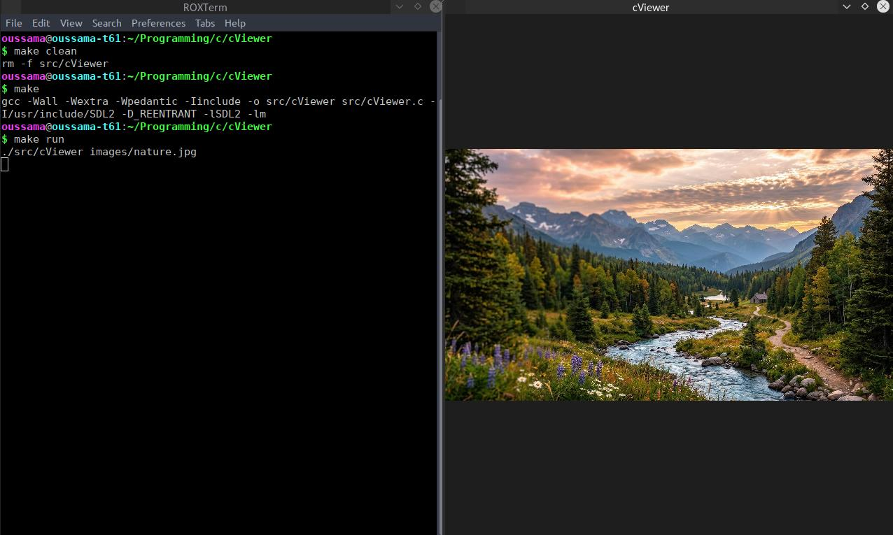

# cViewer

A lightweight image viewer written in C using SDL2 and stb_image.

## Screenshot



## Features

- Load and display images from a command-line file path.
- Support common image formats through stb_image.
- Render images in an SDL2 window.
- Resize the window while preserving the image's aspect ratio.
- Center the image within the window.
- Handle image-loading, SDL initialization, and rendering errors.
- Return a failure exit status when an error occurs.

## Requirements

- GCC or another compatible C compiler
- GNU Make
- SDL2 development libraries
- stb_image (included in `include/`)
ld

## Installation

Clone the repository and navigate to the project directory:

```bash
git clone https://github.com/oussama-dalhi/cViewer.git
cd cViewer
```

## Build

Compile the project using the included Makefile:

```bash
make
```

The executable will be created at `src/cViewer`.

To remove the compiled executable, run:

```bash
make clean
```

## Usage

Run the default test image configured in the Makefile:

```bash
make run
```

To open a specific image, pass its path as a command-line argument:

```bash
./src/cViewer images/wallpaper.png
```


You can also provide an image using an absolute or relative path:

```bash
./src/cViewer /path/to/image.png
```

If the image cannot be loaded or an SDL operation fails, cViewer reports the error and exits with a failure status.

## Project Structure

```text
cViewer/
├── images/          # Sample images
├── include/         # Third-party headers (stb_image)
├── src/             # C source code
├── screenshots/     # Application screenshots
├── Makefile         # Build and run commands
├── .gitignore       # Git ignore rules
├── .gitattributes   # Git file attributes
├── LICENSE          # MIT License
└── README.md        # Project documentation
 ```
## Future Improvements

 - Navigate between previous and next images in the current directory.
 - Add keyboard shortcuts for image navigation.
 - Implement zoom controls.

## Third-Party Libraries

 - [stb_image](https://github.com/nothings/stb) — loads image files into pixel data.
 - [SDL2](https://www.libsdl.org/) — handles window creation, events, and rendering.

## License

This project is licensed under the MIT License. See the [LICENSE](LICENSE) file for details.
