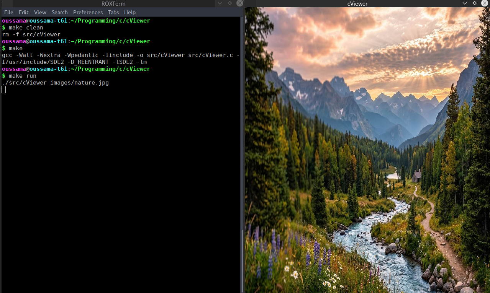

# cViewer

A lightweight image viewer written in C using SDL2 and stb_image.

## Screenshot



## Features

- Load and display images from a file path.
- Support common image formats through stb_image.
- Render images in an SDL2 window.
- Allow the window to be resized.
- Report errors when image loading or SDL initialization fails.

## Requirements

- GCC or another compatible C compiler
- GNU Make
- SDL2 development libraries
- stb_image (included in `include/`)
ld

Clone the repository and enter the project directory:

```bash
git clone https://github.com/oussama-dalhi/cViewer.git
cd cViewer
```

Build the project:

```bash
make
```

## Usage

Run test images:

```bash
make run
```


Open any other image by passing its path as a command-line argument:

```bash
./src/cViewer images/wallpaper.png
```

You can also open another image:

```bash
./src/cViewer images/nature.jpg
```

To remove the compiled executable:

```bash
make clean
```

## Project Structure

```text
cViewer/
├── images/          # Sample images
├── include/         # Third-party image-loading header
├── src/             # C source code
├── screenshots/     # Application screenshots
├── Makefile         # Build and run commands
├── .gitignore
├── .gitattributes
└── README.md
```

## Future Improvements

- Preserve image aspect ratio and center the image in the window.
- Handle window resizing without distorting the image.
- Add zoom controls and keyboard shortcuts.
- Improve error handling and input validation.
- Support navigating between images in a directory.

## Third-Party Libraries

- [stb_image](https://github.com/nothings/stb) — image loading.
- [SDL2](https://www.libsdl.org/) — window management and rendering.

## License

This project is licensed under the MIT License. See the [LICENSE](LICENSE) file for details.
